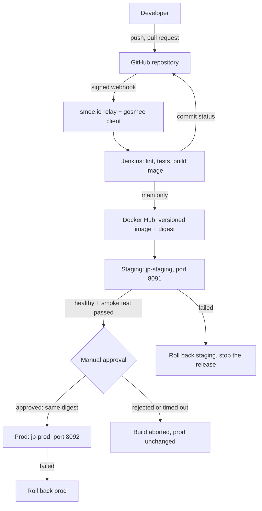

# jenkins-pipeline

A learning project that demonstrates a **CI/CD pipeline with Jenkins and GitHub**.
The app is a deliberately tiny Flask API; the focus is the delivery process:
pipeline-as-code, PR checks, branch protection, Docker images as releases,
staging → approval → prod, and automatic rollback.

## How it works



1. Every pull request is linted, tested and built. A red result blocks the merge.
2. A merge to `main` builds one image, pushes it to Docker Hub and deploys it to staging.
3. After a manual approval, the **same image digest** is deployed to prod (build once, deploy many).
4. A deployment that fails its health check or smoke test is rolled back to the previous image.

Jenkins, staging and prod all run on one Windows machine with Docker Desktop and listen on 127.0.0.1 only.

## The app

| Endpoint | Returns |
|---|---|
| `GET /` | greeting + environment name |
| `GET /health` | `{"status": "ok"}` (used by the Docker health check and smoke tests) |
| `GET /version` | app version + git commit the image was built from |
| `GET /add?a=2&b=3` | `{"result": 5.0}` |
| `GET /multiply?a=2&b=3` | `{"result": 6.0}` |

## Run it locally

```bash
# lint + tests (same image Jenkins uses)
docker build --target test -t jenkins-pipeline-test .
docker run --rm jenkins-pipeline-test

# runtime image
docker build --target runtime -t jenkins-pipeline:dev .
docker run --rm -p 127.0.0.1:8000:8000 jenkins-pipeline:dev
curl http://127.0.0.1:8000/version
```

## Pipeline

Defined in [`Jenkinsfile`](Jenkinsfile), run by a Jenkins Multibranch Pipeline.

| Stage | Runs on | What it does |
|---|---|---|
| Prepare | all branches + PRs | computes the image tag `<version>-<build>-<short sha>` |
| Test | all branches + PRs | `docker build --target test`, runs ruff + pytest, publishes the JUnit report |
| Build image | all branches + PRs | `docker build --target runtime` |
| Push | `main` | logs in to Docker Hub with a token (isolated per-build docker config), pushes the image, records its **digest** |
| Deploy staging | `main` | [`scripts/deploy.ps1`](scripts/deploy.ps1): runs the image **by digest** as `jp-staging` on `127.0.0.1:8091`, waits for the container health check, smoke-tests `/health` + `/version` (must report the built commit), rolls back to the previous image on failure |
| Approve prod | `main` | manual approval in Jenkins (15 min); no executor is held while waiting; reject or timeout aborts the build and leaves prod unchanged |
| Deploy prod | `main` | pulls the **same digest** and runs it as `jp-prod` on `127.0.0.1:8092`, with the same health check, smoke test and rollback as staging |

Branch and PR builds stop after "Build image" (their images are removed again); only `main` is released.

The stages up to "Deploy staging" share one agent allocation, and "Deploy prod" takes a new one after the approval.

### Deployment and rollback

[`scripts/deploy.ps1`](scripts/deploy.ps1) is used for both environments:

1. Remember which image is running now.
2. Replace the container with the new image.
3. Wait until the container's `HEALTHCHECK` reports healthy.
4. Smoke test: `/health` is ok and `/version` reports the commit that was built.
5. If any of this fails: print the container log, start the previous image again and fail the build.

A failed staging deployment ends the build before the approval, so prod is not touched.

### Credentials

Nothing secret is stored in this repository. The GitHub token, the Docker Hub token and the webhook secret are Jenkins
credentials. The Docker Hub login uses a per-build docker config that is deleted after the build.
Pull requests from forks are not built.

### Triggers

Jenkins runs only on the local machine (127.0.0.1), so GitHub cannot call it directly. Webhooks are relayed:

```
GitHub webhook (push, pull_request) → smee.io channel → gosmee client (local) → Jenkins /github-webhook/
```

The webhook is signed with a shared secret (HMAC); Jenkins rejects events without a valid signature.
A periodic branch scan (every hour) is the fallback if the relay is down.

## Branching

Trunk-based: `main` is the only long-lived branch and the only one that deploys.
Changes go through short-lived branches and pull requests; Jenkins must report green before a PR can be merged.

## See it in action

| Pull request | What it shows |
|---|---|
| [#1](https://github.com/stevanoskia/jenkins-pipeline/pull/1) | A deliberately wrong test: the check is red and the merge is blocked until the test is fixed |
| [#2](https://github.com/stevanoskia/jenkins-pipeline/pull/2) | The pipeline extended through a pull request: push to Docker Hub and staging deployment |
| [#4](https://github.com/stevanoskia/jenkins-pipeline/pull/4) | Manual approval and prod deployment |
| [#5](https://github.com/stevanoskia/jenkins-pipeline/pull/5) | A deliberately broken release: the tests pass but the container cannot start, so staging is rolled back and prod keeps the old version |
| [#6](https://github.com/stevanoskia/jenkins-pipeline/pull/6) | The revert that makes `main` releasable again |

## Known limits

- CI does not start the built image, so a container that cannot start is only caught in staging (see [#5](https://github.com/stevanoskia/jenkins-pipeline/pull/5)).
- The rollback was demonstrated in staging. Prod uses the same script, but its rollback has not been triggered.
- Staging and prod share one machine, and Jenkins runs builds on its own node. A real setup would use separate servers and build agents.
